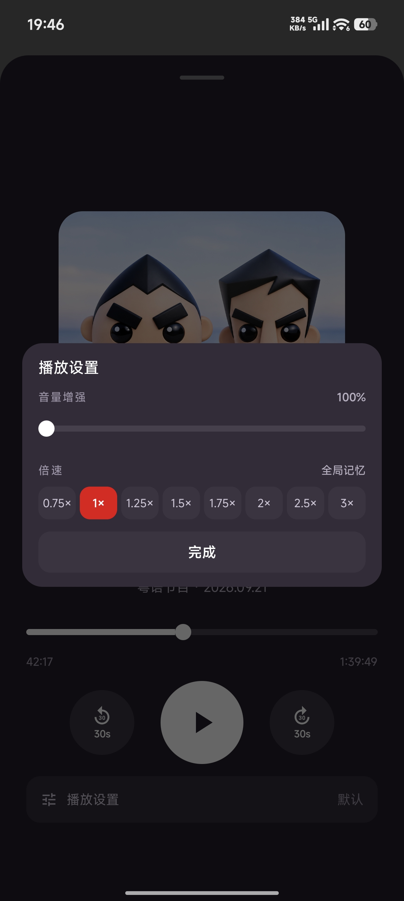
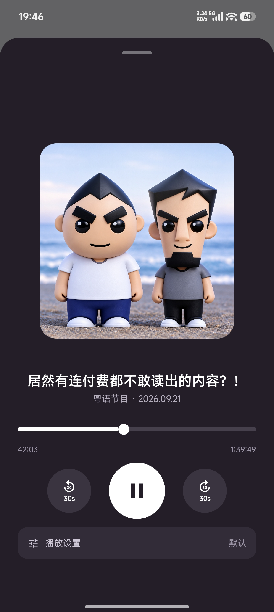
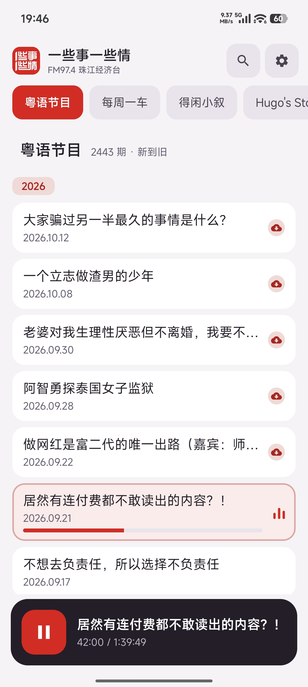
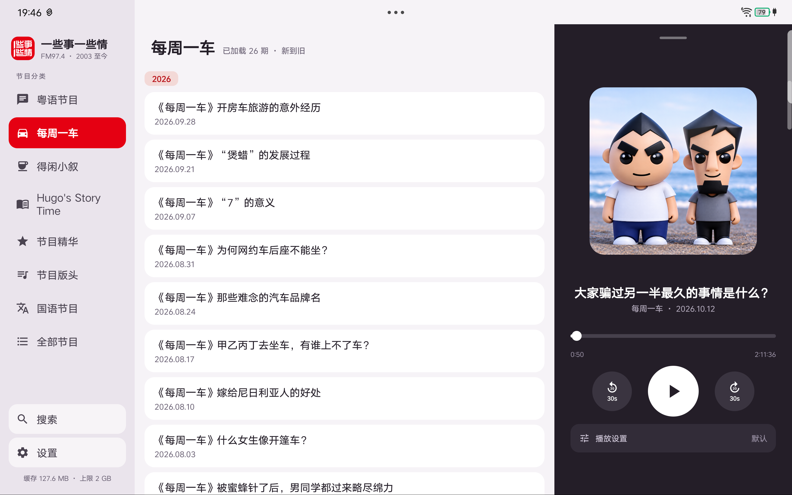

# 一些事一些情 · 播客播放器

精简播放器：只保留官方 App 里「听节目」这一件事，独立实现，无登录、无商城、无推送，只用官网公开数据。
专为 BYD DiLink 4.0 车机设计，同时兼容手机。

> 本应用是非官方第三方客户端，与 LoveQ 官网及《一些事一些情》节目方无任何隶属关系。节目内容版权归原作者所有。本应用不存储、不分发任何音频，仅代为访问官网公开链接。非商业用途。如权利人认为不妥，请通过 pigstrong133@gmail.com 联系，我将立即停止分发并下架。

## 界面预览

| 播放设置 | 全屏播放 |
|---------|---------|
|  |  |

| 节目列表 | 横屏分屏 |
|---------|---------|
|  |  |

## 功能

- 节目列表：2003 年至今全部节目（官网 `program.html?cat_id=1`），下拉刷新、按年份跳转
- 正常播放：后台播放 + 通知栏控制，锁屏可暂停/拖动进度
- 记忆播放进度：每 5 秒保存一次，换集、杀进程都不丢；听完自动标记
- 倍速播放：0.75× ~ 3.0×，全局记忆
- 续播：首页"继续收听"卡片
- 自动连播：一集结束自动播放下一集
- 收听历史：搜索入口进入（横屏在左侧边栏底部，竖屏在顶行图标），播放过的节目按时间倒序，可筛"在听/听完"
- 全库搜索：搜索面板输入标题/日期即时匹配 2300+ 期节目；首次启动后台自动建索引（分两三次、每次约 1 分半建完，之后增量刷新通常只需 1 次请求）
- 收听缓存：听过的片段自动缓存到本地（上限 2 GB，LRU 自动淘汰），重听、续播、回退 30 秒不再耗流量；边栏常驻显示占用，点开可一键清理（保留正在收听的一期）

## 车机适配（DiLink 4.0）

- **横屏三栏**：≥880dp 时渲染为"左侧分类边栏 ｜ 节目列表 ｜ 右侧深色播放面板"，顶栏与 Tab 条全部收进边栏，列表顶到头，播放/倍速/续播一步触达
- **系统分屏**：`resizeableActivity` + 自适应断点，DiLink 左右分屏取半幅时自动回退为单栏（logo 行 + 胶囊分类 + 底部深色迷你播放条），旋转/分屏不重载界面（configChanges）
- **车机可读**：字号整体放大一档，触控目标 ≥ 44dp，播放键 82dp，进度条触控热区 30dp
- **低版本兼容**：minSdk 24（Android 7+），覆盖 DiLink 4.0（Android 10）及更早车机；音频焦点由 Media3 处理，导航播报时自动让路
- 无 Google 服务依赖（无 Play、无 Firebase），车机直接装 APK 即用

## UI 风格

现代扁平 + 圆角矩形，按 `design_preview.html` 重绘：暖灰画布 `#F6F3F7`、边栏 `#EAE4EC`、白色节目卡片、
品牌红 `#E50012`（选中分类/继续收听卡/进度），播放面板固定深色 `#241E28`（Apple Music 风：方形主持人封面、
白色细进度条+圆点、圆形快退快进带 30s 标注、底部倍速分段）。界面不跟随系统深色模式，保证车机观感一致。
界面预览见项目外的 `design_preview.html`。

## 数据来源

全部来自官网公开页面，与浏览器访问完全一致：

- 列表：`https://www.loveq.cn/program.html?cat_id=1&page=N`
- 播放地址：从 `https://www.loveq.cn/program_download-<id>.html` 页面解析带签名的官方音频直链（地址有时效，过期自动重新获取）

节目音频版权归原作者所有，本应用仅为第三方非官方客户端。

## 构建

1. 安装 [Android Studio](https://developer.android.com/studio)（Ladybug 或更新版本，自带 JDK 17）
2. 打开本目录，等待 Gradle 同步
3. Build → Build APKs 生成 APK，拷到车机安装（车机需开启"允许安装未知来源应用"）

无任何登录/注册，所有进度仅保存在本机。

## 许可证

代码以 [MIT License](LICENSE) 开源：可自由使用、修改、分发、商用，只需保留版权声明。

> **注意**：MIT 只覆盖**代码本身**。「一些事一些情」名称、节目音频、主持人封面/logo 等内容的版权归原作者及官网所有，
> 不在本许可证范围内。本应用是第三方客户端，非官方出品，与官网无隶属关系。

